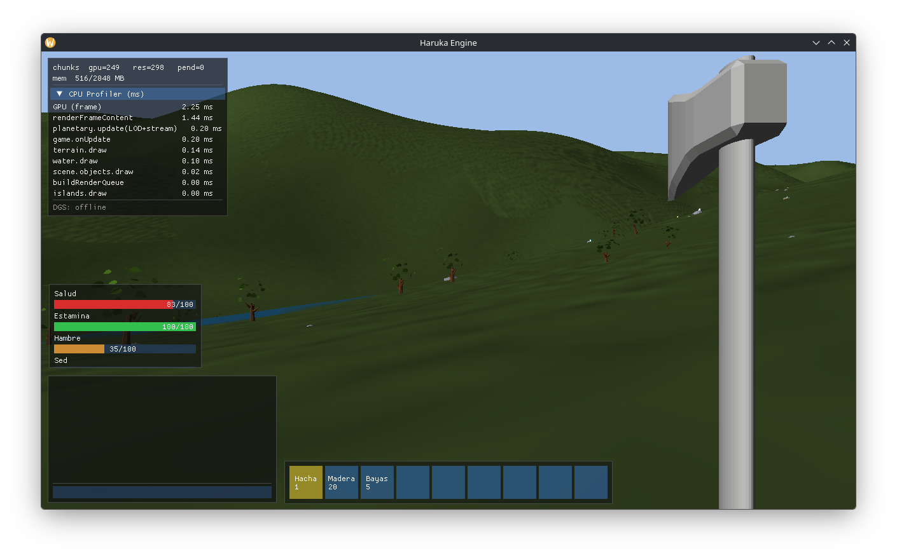
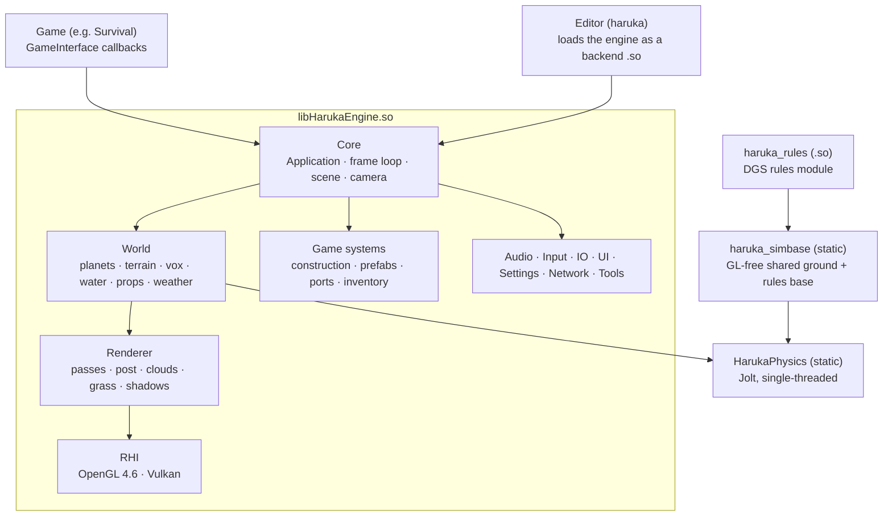

# Haruka Engine

A C++26 real-time engine for **seamless planetary-scale worlds**: you can orbit a planet at its real
size, fly down and walk on it without loading screens. It ships as a shared library
(`libHarukaEngine.so`) and renders through **OpenGL 4.6** or **Vulkan**.

> **Status: active development.** The engine runs end to end, but parts of it are still being
> rebuilt. The [test status](#test-status) section lists what passes, what fails and why. Nothing
> in this README is a promise beyond what those tests show.



---

## What it does

- **Real-scale planets with double precision.** Positions are kept in `double` and the world is
  re-centred on the camera every frame, so GPU floats stay precise from orbit down to a pebble.
- **Terrain as the output of a process.** Elevation comes from a per-seed simulation: plate
  tectonics, then hydrology and erosion, then climate. The same baked fields feed rendering,
  physics, water and prop placement (`Src/Haruka/World/Planet/`).
- **Node-based GPU terrain.** A cube-sphere quadtree of terrain nodes is generated by compute
  shaders and drawn from a node pool (`Src/Haruka/World/Terrain/`).
- **Caves and floating islands.** A chunked volumetric field is meshed with surface nets. It cuts
  holes in the terrain where there is a cave mouth (`Src/Haruka/World/Vox/`, `Src/Haruka/Renderer/VoxRenderer.*`).
- **Atmosphere and weather.** Volumetric clouds formed from an air-column model, deterministic
  weather fronts, precipitation, ocean waves and inland water.
- **Two graphics backends behind one RHI.** OpenGL 4.6 and Vulkan implement the same device
  interface (`Src/Haruka/RHI/`). The backend is a setting; `HARUKA_BACKEND=vulkan|opengl` overrides it for
  one run.
- **Deterministic physics.** Jolt Physics runs single-threaded on purpose, so an authoritative
  server (DGS) can replay the same rules (`haruka_simbase`, `haruka_rules`).
- **Construction and prefabs as data.** Pieces, ports, rails and prefabricated assemblies are
  plain data. A prefab is a JSON file or a `.glb` built in Blender; for a `.glb` the engine reads
  only the node poses, never the geometry (`Src/Haruka/Game/`).
- **Compile-time modules.** Fluids, deformation, soft bodies, networking, audio, particles,
  terrain, post-processing, shadows and physics can be compiled out with a bitmask.

---

## Architecture

### Layers



A game does not subclass the engine. It fills in a `GameInterface`, a table of callbacks
(`onInit`, `onUpdate`, `onRenderWorld`, `onRenderShadow`, `onEvent`, `onShutdown`), and hands it to
`Application` (`Src/Haruka/Core/GameInterface.h`).

### Source layout (`Src/Haruka/`)

Engine headers are included with the library's name as prefix, like `<Jolt/...>` or `<SDL3/...>`:
`#include "Haruka/World/Planet/Planet.h"`. The include root is `Src/`, so a game's own `Core/` or
`UI/` folders can never be confused with the engine's.

| Module | Responsibility | Size |
|---|---|---|
| `Core/` | `Application` (startup, frame loop, render passes), scene and components, camera, logging, locale, cache, propagation (sound/path solver) | 46 files · 7.4 k lines |
| `World/` | Planets (geology, fields, climate, orbits), terrain nodes, volumetric caves, water, props, weather, ground layer | 62 files · 29.4 k lines |
| `Renderer/` | Render passes and their resources: clouds, grass, props, vox, shadows, fluids, post chain | 73 files · 9.0 k lines |
| `RHI/` | Device/context interface with OpenGL and Vulkan backends, pipeline state objects, GPU timestamps | 21 files · 7.5 k lines |
| `Physics/` | Jolt wrapper (PIMPL), planetary gravity, character controller, XPBD soft bodies, shallow water | 20 files · 5.9 k lines |
| `Tools/` | Profiler, debug overlay, editor panels, ProcGraph (procedural node graphs) | 36 files · 7.0 k lines |
| `Game/` | Construction, prefabs, ports and rails, inventory | 13 files · 3.1 k lines |
| `UI/`, `Settings/`, `Input/`, `Audio/`, `IO/`, `Network/`, `Cinematics/` | Interface, settings, keyboard and gamepad actions, OpenAL audio, asset IO, DGS client, camera sequences | 45 files |

### CMake targets

| Target | Kind | Purpose |
|---|---|---|
| `HarukaEngine` | shared | The engine. Requires C++26 publicly (`cxx_std_26`), so every consumer compiles with it |
| `HarukaPhysics` | static | Physics, depends only on glm and an `IWorldProvider` |
| `HarukaConstruction` | static | Construction validation, shared with the server |
| `haruka_simbase` | static | GL-free simulation base: the ground both client and server agree on |
| `haruka_rules` | shared | Rules module loaded by the DGS server with `dlopen` |
| `haruka_tests`, `haruka_tests_rhi` | executables | CPU suite and GPU (RHI) bench, see [Testing](#testing) |
| `mapc`, `bench_dgs_bandwidth` | executables | Map compiler and a DGS bandwidth bench |

### One frame

`Application::renderFrameContent()` (`Src/Haruka/Core/ApplicationRender.cpp`) is the list of passes,
in this order:

1. `frameBegin`: size, post chain, celestial mechanics, near plane, prop scatter, clear
2. `passCompute`: terrain compute, before any render pass opens (a Vulkan requirement)
3. `passSky`: sky, weather, sun and the frame's air
4. `passSceneSetup`: per-frame UBO, lights, physics, tonemapping
5. `passSceneObjects`: scene objects and instanced construction pieces
6. `passProps`: world props
7. `passPlanetUpdate`: planet LOD and streaming
8. `passShadows`: sun shadow map, zenith mask, wet ground
9. `passPlanet`: terrain and water
10. `passGameWorld`: the game's `onRenderWorld` hook
11. `passPrecipitation`, `passFluid`, `passClouds`
12. Post composite: FXAA, bloom, upscale to the backbuffer

### Threads

Jolt runs on one thread by design (determinism for the server). Everything else that runs in the
background goes through **one job system** (`Src/Haruka/Core/Jobs/JobSystem.h`). It has a fixed pool of
threads and three priority queues (frame, streaming, background), plus a queue of continuations
that run on the main thread at the start of the frame. Data that lives on both CPU and GPU goes
through the **resource store** (`Src/Haruka/Renderer/ResourceStore.h`): one revision per resource, one
upload per revision, a shared per-frame upload budget, and GPU objects destroyed only after the
frames in flight are done with them.

Every background thread in the engine and the game now goes through it: the former `std::async`
calls, the planet bake pools, the world provider's ring sampling, the image writer, and the vox
meshes as store resources. The physics library receives the pool through
`PhysicsEngine::setTaskRunner`, because the server links physics without the engine. The game's
voice capture is a registered dedicated thread. Not migrated: `IO/AssetStreamer` and
`Core/Cache/Cache.h`, which nothing uses.

---

## Building

### Requirements

| | Version | Notes |
|---|---|---|
| Compiler | GCC 16 or newer | C++26. Only GCC 16.2 has been tested; Clang and MSVC have not |
| CMake | 3.25 or newer | needed for the `cxx_std_26` compile feature |
| SDL3 | 3.x | not packaged by most distros yet, see below |
| Vulkan headers | optional | the Vulkan backend is compiled only if `<vulkan/vulkan.h>` is found |

System libraries (Fedora; this is the list CI installs):

```bash
sudo dnf install cmake ninja-build gcc-c++ pkgconf-pkg-config \
    glm-devel glslang assimp-devel openal-soft-devel libzstd-devel \
    openssl-devel postgresql-devel gtk3-devel
```

SDL3, if your distro does not ship it:

```bash
git clone https://github.com/libsdl-org/SDL /tmp/SDL
cmake -S /tmp/SDL -B /tmp/SDL/build -DCMAKE_BUILD_TYPE=Release
cmake --build /tmp/SDL/build -j"$(nproc)"
sudo cmake --install /tmp/SDL/build
```

Submodules (Dear ImGui, nativefiledialog, Jolt Physics):

```bash
git submodule update --init --recursive
```

### Configure and build

```bash
cmake -S . -B build -DCMAKE_BUILD_TYPE=RelWithDebInfo
cmake --build build -j6
```

- **Use a modest `-j`.** Several translation units need around 500 MB each; `-j16` has run the
  development machine out of memory.
- **`Debug` is refused** unless you pass `-DHARUKA_ALLOW_DEBUG=ON`. At `-O0` the suite is too slow
  to be useful, and there is a crash that only exists at `-O0`.
- **Tests are not built in `Release`.** Ask for them with `-DHARUKA_BUILD_TESTS=ON`.

### Modules

One character per module, in this order; a missing position counts as on:

| Bit | Module | Bit | Module |
|---|---|---|---|
| 0 | `FLUIDS` | 5 | `PARTICLES` |
| 1 | `DEFORM` | 6 | `TERRAIN` |
| 2 | `SOFTBODY` | 7 | `POSTFX` |
| 3 | `NETWORK` | 8 | `SHADOWS` |
| 4 | `AUDIO` | 9 | `PHYSICS` |

```bash
cmake -S . -B build -DMODULES=0011111111   # fluids and deformation off
```

The mask generates `Src/Haruka/Core/Modules.h` inside the source tree, so the engine and the game must be
configured with the **same** mask. See [docs/MODULES.md](docs/MODULES.md).

### Useful runtime switches

| Variable | Effect |
|---|---|
| `HARUKA_BACKEND=vulkan\|opengl` | Force a graphics backend for this run, without touching settings |
| `HARUKA_FRAMELOG=1` | Mean, p95 and worst frame time every 3 s, plus physics time |
| `HARUKA_DIAG=1` | Turn on per-frame diagnostic logs (off by default) |
| `HARUKA_LOG_LEVEL` | Log verbosity |
| `HARUKA_PROF_LOG=N` | Dump the profiler tree every N frames |
| `HARUKA_COLLISION_WIRE=1` | Draw the collision mesh as a green wireframe |
| `HARUKA_JOLT=0` | Use the in-house solver instead of Jolt |

---

## Testing

| Suite | Command | What it covers |
|---|---|---|
| CPU | `./build/haruka_tests [group]` | Terrain, planets, physics, construction, prefabs, ports, water, clouds, sound, DGS… grouped, simplest first |
| GPU / RHI | `./build/haruka_tests_rhi gl\|vk\|all [group]` | Backend parity, CPU↔GPU terrain parity, water, grass, clouds, lighting, scene |

The group filter matches the group's name or keys. Every parity test carries a **counter-test**
that shows it can fail. A test that only checks "it did not crash" cannot tell a correct
implementation from one that does nothing.

CI (`.github/workflows/ci.yml`) builds the engine with several module masks and runs the RHI
bench without a GPU: OpenGL on Mesa llvmpipe and Vulkan on lavapipe.

### Test status

Measured on 2026-10-10 (GCC 16.2, RelWithDebInfo, RTX 3050 Laptop):

| Suite | Result |
|---|---|
| CPU (`haruka_tests`) | 332 874 checks, **0 failures** |
| RHI Vulkan (`haruka_tests_rhi vk`) | 421 OK, **14 known failures**: grass generation (6), instancing arena (3), terrain stride and relief (3), ocean shading (2). They predate the C++26 move. The cloud blend counter-test also fails intermittently. |

---

## Documentation

| Document | Content |
|---|---|
| [docs/MODULES.md](docs/MODULES.md) | The module bitmask and how to add a module |
| [docs/HISTORIAL.md](docs/HISTORIAL.md) | Development log (Spanish) |
| [docs/guides/](docs/guides/) | Design notes and plans: terrain v5, Vulkan, construction, ports, packaging… (Spanish) |
| Doxygen | `./Tools/build_docs.sh` → `docs/html/index.html` |

---

## Contributing

Contributions are welcome. Read [CONTRIBUTING.md](CONTRIBUTING.md) first (it explains the DCO
sign-off), and [QUALITY.md](QUALITY.md) for the code and testing standards. Please report security
problems privately as described in [SECURITY.md](SECURITY.md), not in public issues. Everyone taking
part follows the [Code of Conduct](CODE_OF_CONDUCT.md).

## License

Licensed under the [Apache License 2.0](LICENSE). You may use, modify and redistribute the engine,
commercially or not, and forks are welcome. Two things travel with every copy:

- **The [NOTICE](NOTICE) file.** Any redistribution, including forks, must keep it (section 4(d)),
  so the origin of the project stays visible.
- **The name.** The license does not grant use of the name "Haruka" (section 6). Please give your
  fork its own name.

Third-party components keep their own licenses; NOTICE lists them.

## Related projects

- **[Survival](https://github.com/Andonigt04/Survival)**: the game built on this engine.
- **[haruka](https://github.com/Andonigt04/haruka)**: the editor. It loads this engine as a
  backend plugin and can also drive a remote engine.
